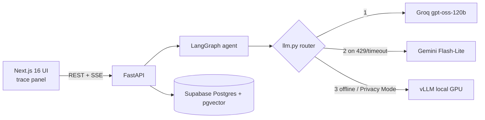

# <Project name>

> <one-line pitch>

[](https://github.com/Suyash728/hackathon-starter/actions/workflows/ci.yml)
<!-- New repo from this template? Replace Suyash728/hackathon-starter in the badge URL. -->



## How to use this template
1. On GitHub: **Use this template → Create a new repository**, then clone it.
2. One-time agent toolkit setup per machine (global skills + context7/playwright MCP): see [docs/TOOLKIT.md](docs/TOOLKIT.md).
   Per event, `bash scripts/event-mcp.sh <supabase-ref>` adds project-scoped MCP servers.
3. Pick the playbook for the event length (the playbooks live outside this repo):
   **Sprint** (<= 6 h) · **Lite** (6-24 h) · **Full** (> 24 h).
4. Set the coverage gate for that playbook: Sprint `COV_MIN=40`, Lite `60` (default), Full `75`.
   Change it in **both** `.github/workflows/ci.yml` (`env:`) and `scripts/ci-local.sh`, at the start of the
   event only; never lower it mid-event to make CI pass.
5. Fill `AGENTS.md` (Purpose, MUST/WON'T) and `docs/traceability.md`, then run:
   `bash scripts/dev.sh` · `bash scripts/ci-local.sh` · `bash scripts/smoke_demo.sh`.
6. Optional persistence: [docs/SUPABASE.md](docs/SUPABASE.md).

## Quickstart
```bash
cp .env.example .env              # fill keys
cd backend && uv sync && cd ..
cd frontend && npm ci && cd ..
bash scripts/dev.sh               # API :8787, UI :3000
bash scripts/smoke_demo.sh
bash scripts/ci-local.sh          # the same checks CI runs
```

## Env vars
`GROQ_API_KEY`, `GEMINI_API_KEY`, `VLLM_BASE_URL`, `VLLM_MODEL`, `PRIVACY_MODE`,
`SUPABASE_URL`, `SUPABASE_PUBLISHABLE_KEY` (optional, see docs/SUPABASE.md), `NEXT_PUBLIC_API_URL`, `CORS_ORIGINS`,
`LLM_MOCK` (tests/CI), `LLM_CACHE_TTL`, `RATE_LIMIT`, `MAX_INPUT_CHARS`

## Rubric alignment
Fill from [docs/traceability.md](docs/traceability.md): one row per judging criterion.

| Criterion | Requirement IDs | Where to see it |
|---|---|---|
| <criterion 1, e.g. Problem alignment> | R1, R2 | <screen / demo mm:ss> |
| <criterion 2, e.g. Technical execution> | R3, NF4 | <screen / demo mm:ss> |
| <criterion 3, e.g. Accessibility> | NF2 | <screen / demo mm:ss> |

## Quality evidence
| Check | Tool | Status |
|---|---|---|
| CI (agent guards, lint, types, tests, audits, e2e, secrets) | [`.github/workflows/ci.yml`](.github/workflows/ci.yml) | see badge |
| Backend tests + coverage (gate: `COV_MIN`=60%) | pytest + pytest-cov | 44 tests · 94% |
| Frontend unit tests | vitest + Testing Library | 5 tests |
| Demo path + accessibility | Playwright + axe (WCAG 2.2 AA tags, no serious/critical) | passing |
| Static security | bandit (medium+), eslint `jsx-a11y/strict`, gitleaks | clean |
| Dependencies | pip-audit, `npm audit --audit-level=high` (every CI run) | see CI |
| Lighthouse (prod build) | `bash scripts/lighthouse.sh <url>` | Perf 100 · A11y 100 · Best practices 100 |

_Figures measured on 2026-11-24 for the template; re-run per event and update this table._

**Security measures:** security headers + CSP on UI and API, CORS allow-list from `CORS_ORIGINS`, per-IP rate
limit on LLM routes, Pydantic validation with size limits, every error in the `{success, data, error}` envelope,
human approval before irreversible agent actions, secrets server-side only. Details: [SECURITY.md](SECURITY.md).

**Accessibility:** target WCAG 2.2 AA: labelled landmarks and controls, keyboard path, visible focus,
`aria-live` for the streamed agent trace and results; axe runs on every CI build.

**Traceability:** every requirement maps to a feature, test and demo moment in [docs/traceability.md](docs/traceability.md).

## Works offline
Toggle **Privacy Mode**: every model call goes to a local vLLM server on the presenter's GPU.

## AI disclosure
See [AI_DISCLOSURE.md](AI_DISCLOSURE.md).

## License
MIT, see [LICENSE](LICENSE).
